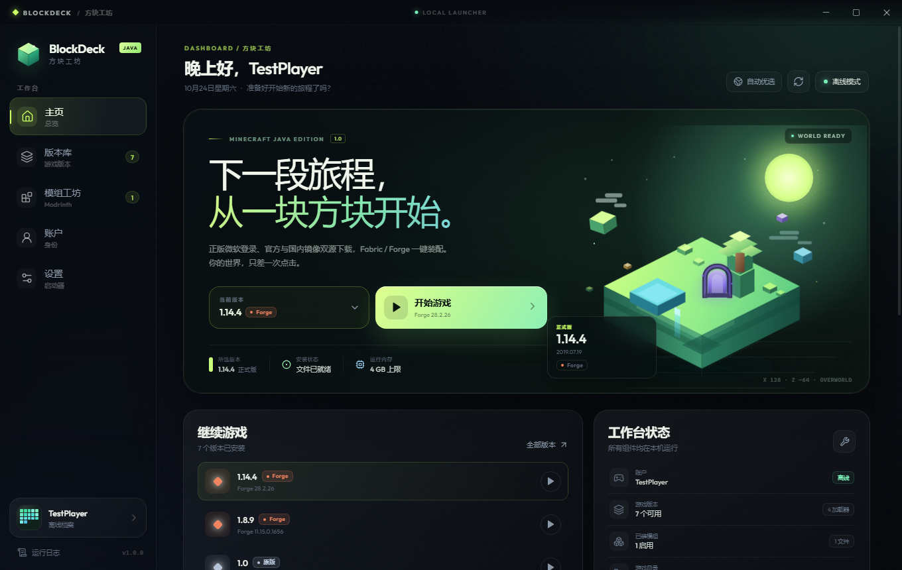
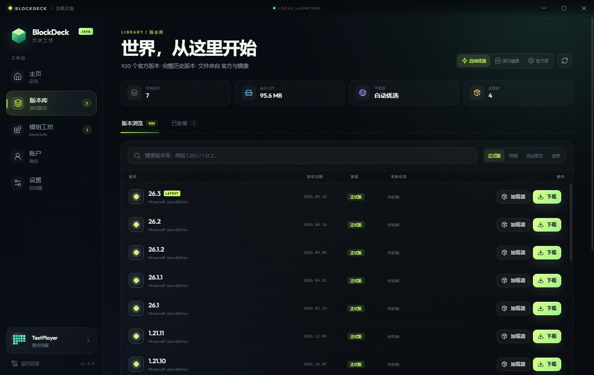
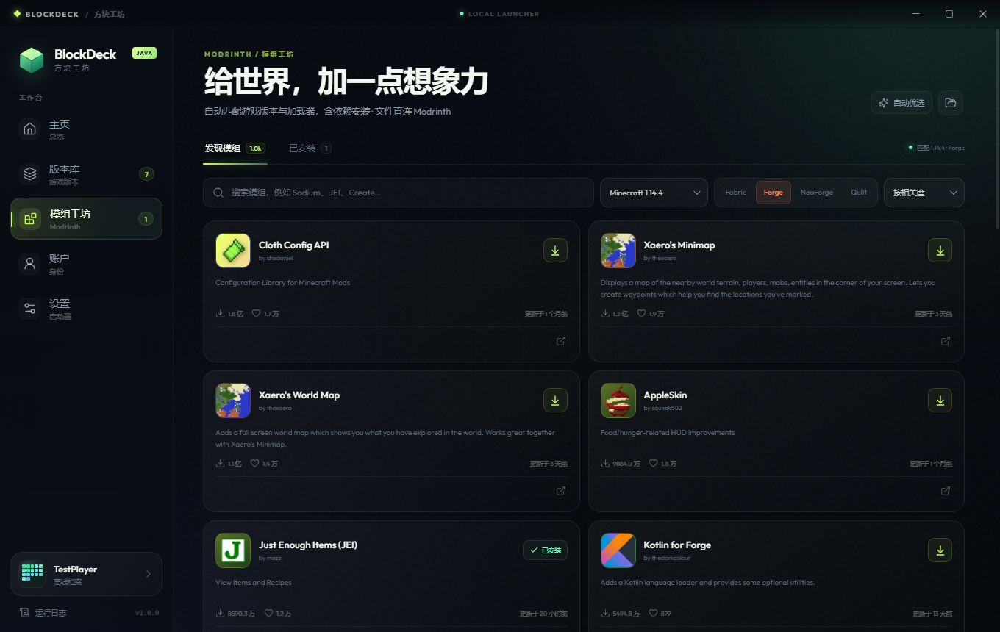
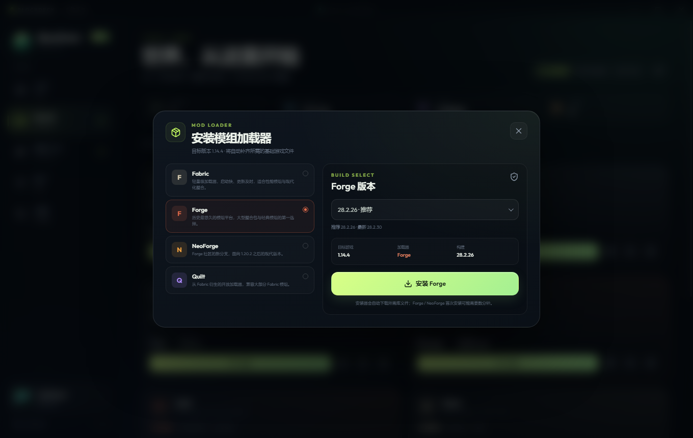

# BlockDeck · 方块工坊

一个面向 Windows 的 Minecraft Java 版桌面启动器。使用 Electron、React 与 TypeScript 构建，把版本管理、正版登录、模组、Java 运行时与联机大厅放进同一个现代化界面。



## 下载

前往仓库的 **Releases** 页面下载：

- **安装版**：带安装向导、快捷方式和卸载程序，启动时请求管理员权限。
- **免安装版**：解压即用，适合放在移动硬盘或自定义目录。

> 当前构建未使用商业代码签名证书，Windows SmartScreen 可能提示“发布者未知”，详见下方「发布说明」。

## 核心功能

### 正版与离线，双账户体系

- Microsoft 账户登录：在启动器内完成官方登录，自动读取正版档案、皮肤与披风。
- 离线档案：按标准 `OfflinePlayer` 规则生成本地 UUID，适合单人、局域网和模组测试。
- 多账户保存与一键切换；访问令牌使用 Windows DPAPI 加密保存在本机。

### 官方源 + 国内镜像，历史版本齐全

- 官方 Mojang 源与 BMCLAPI 国内镜像可选，自动模式优先镜像、失败回退官方。
- 完整读取官方版本清单，支持正式版、快照、Beta、Alpha 等历史版本。
- 自动处理客户端、libraries、natives、assets、旧版资源映射、日志配置与 SHA1 校验。

### 模组加载器，一键装配

- **Fabric**、**Quilt**：读取官方 profile，自动补齐依赖并继承原版启动参数。
- **Forge**：静默安装器自动安装；对 1.8.9 等旧版安装器提供兼容安装流程。
- **NeoForge**：支持 1.20.1 兼容分支与 1.20.2+ 构建。

### 模组工坊

- 直接搜索 Modrinth，按游戏版本与加载器精确筛选。
- 自动安装 required 依赖，文件写入 `mods/` 并保留来源信息。
- 已安装模组支持启用 / 禁用 / 删除；禁用只是重命名，不会误删文件。

### 联机大厅

- **服务器收藏夹**：添加 `host:port`，查看在线人数、MOTD、版本、延迟与图标。
- **一键加入**：选择已安装版本后启动游戏并直接连接服务器。
- **加密房间**：通过联机码创建或加入端到端加密的直连房间，不经过第三方中转；适合同一局域网、公网 IP 或已配置端口映射的场景。

### Java 与启动管理

- 自动检测系统 Java、受管 Java 和自定义 Java 路径。
- 缺失时从国内镜像下载 Temurin JRE，官方 Adoptium 作为回退。
- 自动生成继承版本、classpath、natives、资源索引与旧版启动参数。
- 可调内存上限、并行下载数、启动后最小化；内置实时日志抽屉，安装器与游戏输出一目了然。

## 界面

| 版本库 | 模组工坊 |
| --- | --- |
|  |  |

| 加载器安装 |
| --- |
|  |

## 技术栈

- Electron 38 + React 19 + TypeScript
- Vite / electron-vite 构建
- Node.js 原生网络与加密能力
- Windows DPAPI 保护本地凭证

## 为什么是 BlockDeck

- **本地优先**：账户、设置、日志和游戏数据都在本机；没有遥测上传。
- **一站式**：正版登录、版本下载、加载器、模组、Java、联机，不必再装一排工具。
- **面向国内网络**：官方与国内镜像双源，Java 运行时走国内镜像，Forge / NeoForge 支持 BMCLAPI Maven。
- **开箱即用的界面**：自绘方块岛首页、玻璃拟态面板、实时任务进度与统一的日志抽屉。
- **可诊断**：下载、安装器、游戏 stdout/stderr 都有记录，出问题不用猜。

## 从源码运行

要求 Node.js ≥ 22.12。

```bash
npm install
npm run dev
```

生产构建：

```bash
npm run typecheck
npm run build
```

生成 Windows 免安装目录并打包：

```bash
npm run package
```

`npm run package` 会生成 `release/BlockDeck-win32-x64` 与便携版 zip；如果本机安装了 NSIS 3（或放在 `.tools/nsis`），还会生成安装版。安装版启动时会自动请求管理员权限。

### 项目结构

```text
electron/main/     Electron 主进程、账户、下载、加载器、Java、联机与启动
electron/preload/  contextBridge API
src/pages/         主页、版本库、联机大厅、模组工坊、账户、设置
src/components/    侧栏、标题栏、任务进度、日志抽屉、弹窗等
shared/            主进程与渲染进程共享类型
scripts/           打包、安装器、代码签名脚本
docs/              README 截图
```

## 发布说明

- Windows 的 SmartScreen 依据 Authenticode 数字签名与 Microsoft 声誉判断，文件属性中的公司名不能替代签名。
- 当前发布构建没有商业代码签名证书，因此可能出现“发布者未知”的 SmartScreen 提示。若以 Jordan8868 名义取得受信任的代码签名证书，可使用 `scripts/sign.ps1` 签名主程序、安装包并重新生成便携版。
- 安装版使用当前用户目录，卸载不会删除游戏目录和账户数据。
- 加密房间是直连模式，需要房主网络可达；不提供自动 NAT 穿透或公共中转。
- 未集成 CurseForge；模组来源为 Modrinth。
- Fabric 首次启动需要在游戏目录写入重映射缓存，请确保目录可写。

## 隐私

BlockDeck 不上传账户信息，不包含遥测。Microsoft 登录令牌使用 Windows DPAPI 加密保存在本机；删除账户会同时删除本地令牌。游戏下载、Modrinth 查询与服务器状态查询会访问对应公开服务。

## License

本项目使用 [MIT License](LICENSE) 开源，版权所有 © 2026 Jordan8868。

---

BlockDeck 是非官方 Minecraft 启动器，与 Mojang、Microsoft、Fabric、Forge、NeoForged、Modrinth 无隶属关系。Minecraft 是 Mojang Studios 的商标。
